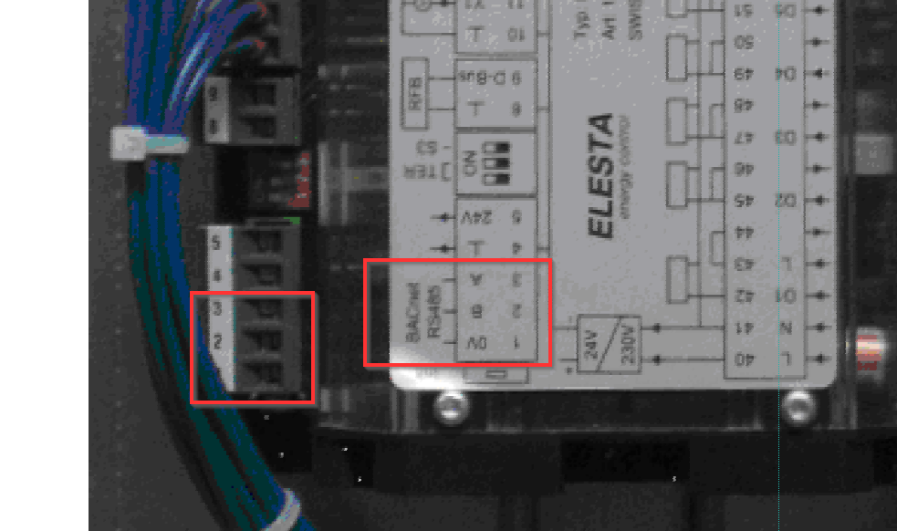

# ComfoBox MQTT Gateway

Connect to a **Zehnder ComfoBox Series 5** with an **ELESTA controller** over RS485 / BACnet MS-TP,
read all values, write selected ones, and publish everything to **MQTT** for Home Assistant.
A built-in web UI, a REST API and generated Home Assistant discovery come with it.

```
ComfoBox (ELESTA) ──RS485/USB──▶ Gateway (.NET 10) ──MQTT──▶ Home Assistant
                                        │
                                        └──HTTP──▶ Web UI / REST API
```

> [!WARNING]
> ## This version is **pre-release and untested against real hardware**
>
> The rewrite described here **has never successfully talked to a physical ComfoBox**. Not once.
> Every value, every write, every protocol detail in this repository is derived from the
> original sources, the BACnet object scan and the published item catalogue — **not** from a
> verified session on a running heating unit.
>
> The new version is therefore **not released**. There is no stable release, no support
> promise and no guarantee that it will work with your controller.
>
> Until a real ComfoBox has answered, treat this code as a **development preview**:
>
> * expect protocol-level defects (addressing, token handling, timing);
> * expect values to stay empty, stale or wrong;
> * **do not** enable write access on a heating unit you care about;
> * the write counter and the expert mode are implemented and tested — but only in simulation.
>
> The last version that was used in production is the **legacy .NET Framework code** in
> [`src_old/`](src_old/) (see [Legacy source](#legacy-source)).

---

## Documentation

All user documentation is in **English** under [`docs/en/`](docs/en/README.md).
The German specification of the project (inventory, modernisation target, ADRs) stays in
[`docs/`](docs/README.md) and is developer material.

| I want to … | Read |
|---|---|
| install on a **Raspberry Pi** with one command | [`docs/en/install-raspberry-pi.md`](docs/en/install-raspberry-pi.md) |
| install on a **Synology NAS (DSM 7)** | [`docs/en/install-synology.md`](docs/en/install-synology.md) |
| run it with **Docker Compose** anywhere | [`docs/en/install-docker.md`](docs/en/install-docker.md) |
| add it to **Home Assistant** (HACS + MQTT) | [`docs/en/home-assistant.md`](docs/en/home-assistant.md) |
| secure the UI and create an **API token** | [`docs/en/security.md`](docs/en/security.md) |
| use the **REST API** | [`docs/en/rest-api.md`](docs/en/rest-api.md) |
| fix a problem (no serial port, no answer, 401/403 …) | [`docs/en/troubleshooting.md`](docs/en/troubleshooting.md) |
| understand the **design** | [`docs/en/architecture.md`](docs/en/architecture.md) |

The in-app help section (`/help` in the web UI) is the **German** user documentation
(`docs/benutzer/`). The UI itself is translated into **German, English and French**.

## Features

* **BACnet MS/TP over RS485** — the protocol stack was ported 1:1 from the legacy code, not rewritten.
* **MQTT 5** via MQTTnet 5 — TLS, authentication, retained values, availability.
* **Home Assistant discovery** with availability topic and a restart button.
* **Web UI** (Angular 22, Optimus UI) — dashboard, item browser, diagnostics, log viewer,
  help, and a getting-started wizard. Languages: **DE / EN / FR**.
* **REST API** with a documented error model.
* **Write protection** — a persistent 24 h write counter (default 200) protects the EEPROM.
  An invalid value is rejected; a default value is never written.
* **Security** — optional sign-in for the UI (PBKDF2-hashed password, HttpOnly session cookie)
  and **API tokens** with a scope (`read`, `control`, `admin`) and an optional expiry.
* **One image** serves both the API and the SPA — no second nginx container.

## MQTT compatibility

The MQTT contract of the legacy client is **unchanged**, because existing Home Assistant and
openHAB setups depend on it:

| Purpose | Topic |
|---|---|
| Values | `{BaseTopic}/{Group}/{Name}` |
| Write a value | `{BaseTopic}/{Group}/{Name}/Set` |
| Enum as number | `{BaseTopic}/{Group}/{Name}/AsNumber` and `…/AsNumber/Set` |
| Availability | `{BaseTopic}/Connected` (`1` / `0`) |
| Version | `{BaseTopic}/Version` |

`BaseTopic` defaults to `ComfoBox`. Enum **names** are never renamed. New topics are only added
under `ComfoBox/Status/` and `ComfoBox/Command/`.

The complete topic list is in [`docs/topics.md`](docs/topics.md).

## Quick start (Raspberry Pi)

```bash
curl -fsSL https://raw.githubusercontent.com/RF77/comfobox-mqtt/master/deploy/pi/install.sh | sudo sh
```

The script installs Docker if needed, pulls the gateway image, writes a compose file and starts
a container with `restart: unless-stopped`, so the gateway survives a reboot.
Details and options: [`docs/en/install-raspberry-pi.md`](docs/en/install-raspberry-pi.md).

> Requires a **64-bit** OS (`aarch64`). .NET 10 no longer supports 32-bit ARM.

## Build and test

```bash
dotnet build src/ComfoBox.sln -c Release
dotnet test  src/ComfoBox.sln -c Release

cd src/ComfoBox.Web && npm ci && npm start
```

| Requirement | Version |
|---|---|
| .NET SDK | 10.0.400 (pinned in `global.json`) |
| Node.js | 22 |
| Docker | 27+ |

Repository layout, coding rules and the German specification are described in
[`docs/README.md`](docs/README.md) and [`.github/copilot-instructions.md`](.github/copilot-instructions.md).

## Hardware

You need an RS485 port (USB RS485 adapter, e.g. CH340 or FTDI) and an A/B cable to the
ComfoBox controller.



*Red: the ComfoBox controller — green: the RS485 pins.*

> The ComfoBox must be switched to **38400 baud** and restarted. The factory default is 76800;
> at 76800 the unit will not answer.

## Legacy source

The original implementation (.NET Framework 4.5.2, C# 6, M2Mqtt, log4net, WPF demo client,
Windows service, Mono on a Raspberry Pi) is kept **unchanged** in [`src_old/`](src_old/):

| Project | Purpose |
|---|---|
| `src_old/Bacnet/` | the original BACnet MS/TP codec and transport |
| `src_old/ComfoBoxLib/` | the item catalogue and read/write logic |
| `src_old/ComfoBoxMqtt/` | MQTT publishing and topic mapping |
| `src_old/ComfoBoxMqttConsole/` | console host (Mono/Linux) |
| `src_old/ComfoboxService/` | Windows service host |
| `src_old/DemoClient/` | WPF demo client |

`src_old/` is **archive**: it is not built, not maintained and not part of the solution.
It is the reference for protocol behaviour, item metadata and known error patterns.

The legacy release binaries and installers are still available on the
[releases page](https://github.com/RF77/comfobox-mqtt/releases).

## Disclaimer

Use at your own risk. You may lose your warranty. Values are written to an **EEPROM**
(≈1,000,000 write cycles), which is exactly why the write counter exists.
Never disable it on hardware you depend on.

Feedback is welcome — please open an issue.

