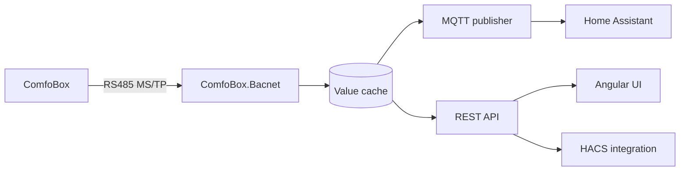

# Architecture

> [!WARNING]
> Pre-release software — see [Status](README.md#status).

## Layers

```
src/
├── ComfoBox.Domain/       item catalogue, value types      (no dependencies)
├── ComfoBox.Bacnet/       MS/TP stack + serial transport   (System.IO.Ports + logging only)
├── ComfoBox.Gateway/      host: BACnet + MQTT + REST + SPA (MQTTnet, ASP.NET Core)
├── ComfoBox.Web/          Angular 22 + Optimus UI          (talks only to the REST/SSE API)
└── ComfoBox.*.Tests/      unit, integration, contract tests
```

Rules:

* `ComfoBox.Domain` has **no** dependency — not even on `ILogger`. It must stay framework-free.
* `ComfoBox.Bacnet` may only use `System.IO.Ports` plus the logging abstraction.
* no cycles between projects.

## Data flow



The **value cache** is the single source of truth for `GET /api/items` and for MQTT. A successful
write is put into the cache immediately, so the UI and Home Assistant see the new value without
waiting for the next poll.

## The BACnet stack

The MS/TP codec and the state machine were **ported 1:1** from `src_old/Bacnet`, not rewritten.
Golden-file tests were derived from the BACnet object scan and must stay green without changing a
fixture.

Only MS/TP over a serial port is supported. Pipe, UDP and PTP were removed.

**The hot path does not log.** An MS/TP token is valid for 95 ms. Writing a log line inside the
token window makes the gateway lose the token. Events are collected in a lock-free buffer and
evaluated afterwards — that is what the *BACnet bus* diagnostics tab shows.

Numbers are formatted culture-invariant everywhere (`InvariantCulture`), because a German
locale turned `21.5` into `215` and broke writes in the legacy version.

## Write protection

```
PUT /api/items/{id}
      │
      ├─ validate (range, enum name, expert mode)
      ├─ WriteCounter.Increment()   ← persistent, 24 h window, default 200
      ├─ BACnet write
      └─ ValueCache.Update()
```

The counter lives in the data volume, not in process memory, so restarting the container does not
reset it. Nothing bypasses it: not MQTT, not the UI, not the REST API.

An **invalid** value is rejected before the counter is touched, and a default value is never
written — especially not `0`.

## Security

```
request ──▶ ApiAccessGuard.GetIdentity()
              ├─ Authorization: Bearer cbk_…   → token store (PBKDF2 verify, cached)
              ├─ Authorization: Basic …        → administrator
              └─ Cookie cbk_session            → session store
```

Deliberately **not** the ASP.NET authentication middleware: the middleware order
(Authentication → Authorization → endpoint) is a classic source of silent misconfiguration.
The check happens explicitly in the endpoint, which makes the behaviour obvious and directly
testable.

PBKDF2 with 600,000 iterations takes a few hundred milliseconds, so a successful verification is
cached and keyed to the **version** of the token store. Any change to the store invalidates the
cache, which makes a revocation effective immediately.

## MQTT

* MQTT 5, MQTTnet 5 — async, TLS, authentication.
* `keepAlivePeriod` is 30 s. The legacy value of 2 s got the client kicked by brokers.
* `ComfoBox/Connected` is published on **every** connect, not only on the first one — otherwise
  availability stays `offline` after a reconnect.
* Home Assistant discovery messages are retained; values are retained according to
  `useMqttRetain`.

The topic contract is frozen. See [the README](../../README.md#mqtt-compatibility).

## One image

The ASP.NET host serves the compiled SPA from `wwwroot` and the API from the same origin. No
second nginx container, no CORS, no reverse-proxy configuration. See ADR-007 in
[`docs/05-entscheidungen/`](../05-entscheidungen/README.md).

## UI

* Angular 22, standalone components, no NgModules.
* **Signals** for state; `inject()` instead of constructor injection.
* **i18n** — typed dictionaries in `src/app/core/i18n/`. A missing key breaks the build, so no
  language can ship half-finished. Locales: `de-DE`, `en-GB`, `fr-FR` (numbers and dates follow the
  language).
* UI texts are localised; **API error messages are German** (the stable `error` code is the
  language-neutral part).

## Tests

| Project | What |
|---|---|
| `ComfoBox.Domain.Tests` | catalogue, value types, validation |
| `ComfoBox.Bacnet.Tests` | codec golden files, MS/TP state machine |
| `ComfoBox.Gateway.Tests` | API, MQTT mapping, security, write counter |
| `ComfoBox.Contract.Tests` | MQTT topic/payload compatibility — fixtures must not change |

```bash
dotnet test src/ComfoBox.sln -c Release
```
